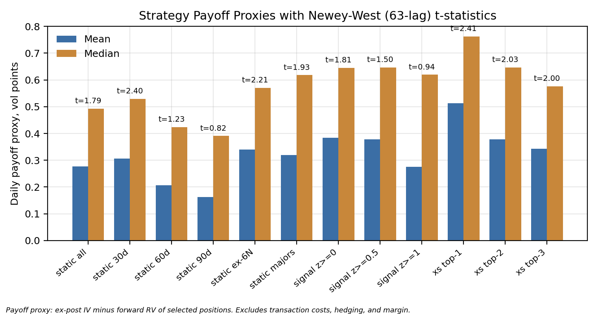
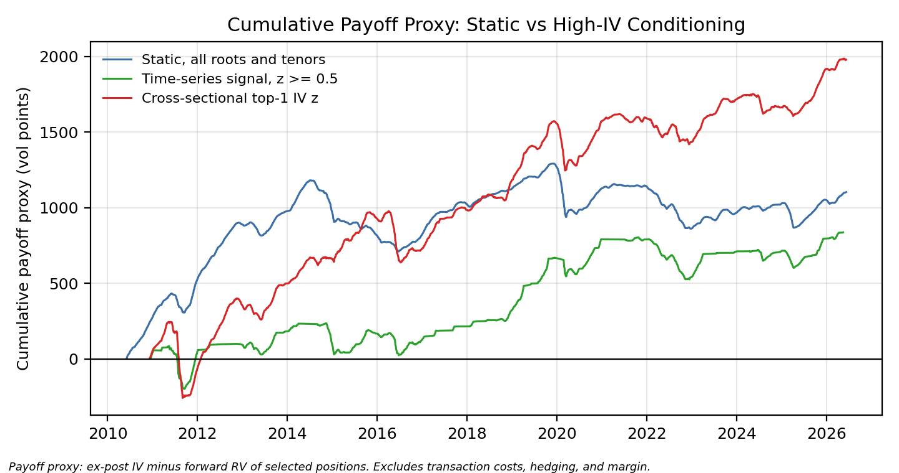

# Volatility Risk Premia in CME G10 FX Options on Futures

Does option-implied volatility systematically exceed the volatility that is subsequently realised,
and does conditioning on high implied volatility improve a short-volatility payoff? A research-grade
study on CME G10 FX options on futures, June 2010 to June 2026, built from exchange-level Databento
GLBX.MDP3 statistics and definitions (6 batch jobs, 986 DBN files, 11 GB raw).

Nicholas Hong · Nanyang Technological University

**Paper:** [`paper/vrp_paper.pdf`](paper/vrp_paper.pdf) · **Long-form report:** [`report/vrp_report_final.md`](report/vrp_report_final.md) · **Executed notebook:** [`notebooks/vrp_analysis.ipynb`](notebooks/vrp_analysis.ipynb)

---

## Findings

All numbers are **payoff proxies** (ex-post implied minus forward realised volatility of the
selected cells), not executable P&L: no transaction costs, delta hedging, or margin.

| Result | Number |
|---|---|
| Median IV − RV spread positive | 6 of 7 roots; strongest JPY +0.87 vol points, NZD flat (−0.03) |
| Static short-vol proxy, all roots and tenors | mean 0.28 vol points/day, median 0.49, positive 65.6% of days, **NW63 t = 1.79**, non-overlapping t = 2.27 |
| Static by tenor | 30d is the only robustly significant bucket (NW63 t = 2.40); 60d and 90d positive but weak |
| Leak-free cross-sectional rule: short the single most IV-elevated root per date and tenor | mean **0.51**, median 0.76, positive 67.2%, **NW63 t = 2.41**, non-overlapping t = 2.71; monotone attenuation for top-2 and top-3 |
| Time-series thresholds (own z-score ≥ 0 / 0.5 / 1) | add little once the z-score is restricted to trailing information |
| Distribution | left-skewed everywhere: static skew −1.69, excess kurtosis 7.0; **2022 is negative for all seven roots** |





The premium is real but insurance-like: the mean sits below the median in all twelve strategy
variants, and the improvement from conditioning is in payoff magnitude, not hit rate.

## Two data contributions

**The 2017 CME FX options symbol migration.** CME sunset the legacy American-style FX option
families in mid-2017 and replaced them with expiration-only European-style contracts under new
symbols. A naive symbol query shows a false post-2017 discontinuity.

| New symbol (post 2017-07) | Economic root | Currency |
|---|---|---|
| ADU | 6A | AUD |
| GBU | 6B | GBP |
| CAU | 6C | CAD |
| EUU | 6E | EUR |
| JPU | 6J | JPY |
| CHU | 6S | CHF |
| 6N (unchanged) | 6N | NZD |

Source rule: pre-2017-07 legacy symbols for all seven roots; from 2017-07 the new symbols for
6A/6B/6C/6E/6J/6S plus legacy 6N only.

**The legacy 6N anomaly.** Settlement prints implying 30–40 percent volatility against roughly
8 percent realised, on zero-open-interest contracts, persist through 2013 (102 of the 103
zero-OI cells with IV > 20 percent sample-wide are 6N in 2013). 6N enters the sample from
2014-01-01.

## Method

- Black-76 ATM implied volatility per contract; r = 0, τ = days-to-expiry / 365.25.
- Forward realised volatility from the **specific underlying futures contract** of each option
  over (t, t+H] calendar days, trading-day annualised; gap guard of 14 calendar days.
- ATM tenor assignment to 30/60/90-day targets by nearest tenor; global de-duplication and
  re-ranking on (tenor distance, |log-moneyness|, open interest).
- IV z-score for conditioning: per root-tenor, trailing 252-observation rolling mean/std ending at
  t−1, minimum 126 observations. **No look-ahead.**
- Inference: Newey-West t at 5/21/63 lags and non-overlapping 21-day subsamples; skew and kurtosis
  reported for every variant; all twelve tested strategies disclosed in
  `results/robust_strategy_summary_v3.csv`.

Full methodological rules, join logic and known data notes are in `report/vrp_report_final.md`
§3–§4 and §7.

## Pipeline

| Step | Script | Purpose | Key output (rows) |
|---|---|---|---|
| 0 | `00_inventory.py` | folder/manifest inventory | `diagnostics/inventory_summary.csv` |
| 1 | `01_convert.py` | DBN.ZST → parquet by role and month | 986 files |
| 2 | `02_coverage_audit.py` | stat-type and root-month coverage | diagnostics |
| 3 | `03_join_diagnostic.py` | benchmark months vs prior counts | all EXACT |
| 4 | `04_build_clean_v3.py` | monthly joined panels | 193 files, 32,525,006 |
| 5 | `05_validate_clean_v3.py` | validation vs targets | scorecard |
| 6 | `06_atm_export.py` | ATM 30/60/90 export, dedup, rerank | 440,467 |
| 7 | `07_black76_iv.py` | Black-76 IV | 440,462 valid |
| 8 | `08_research_panel.py` | research filters | 430,630 |
| 9 | `09_futures_settle_series.py` | futures settle series and log returns | 485,057 / 482,449 |
| 10 | `10_vrp.py` | forward realised vol and VRP panel | 430,630 (427,774 RV ok) |
| 11 | `11_daily_panel.py` | daily (date, root, tenor) panel; 6N from 2014 | 70,714 |
| 12 | `12_strategy_proxy.py` | 12 strategy payoff proxies, leak-free IV z | 40,887 strategy-days |
| 13 | `13_robust_stats.py` | NW 5/21/63 t, non-overlap t, skew/kurtosis | 12-row summary |
| 14 | `14_charts_tables.py` | publication charts and tables 1–4 | 7 charts, 4 tables |
| — | `build_notebook.py` | build and execute `notebooks/vrp_analysis.ipynb` | notebook |
| 15 | `15_intraday_bars.py` | Databento one-minute futures bars, monthly CSVs for q | — |
| 16 | `16_intraday_rv.py` | forward RV from 5-minute returns (q/ or pandas); settlement and intraday panels on the same rows | — |
| 17 | `17_rv_estimator_compare.py` | the twelve strategies under each estimator | — |

Steps 1, 2, 4, 6 and 9 are long and accept `--budget <minutes>` for resumable batches. The rebuild
from the Databento download matched the original pipeline on 21 of the 22 comparable metrics in
`diagnostics/reproduction_scorecard.csv`; the single difference is 20 rows in 32.5 million
(Databento reprocessing, no downstream effect), and every derived panel reproduces exactly.

## In progress: does the premium survive a better realised-volatility estimator?

Forward realised volatility here comes from about 21 daily settlement returns for a 30-day option. That
estimator is unbiased for variance, but realised volatility is its square root, so its noise biases
volatility down and the IV − RV spread up, by more at shorter tenors. Steps 15 to 17 and the kdb+/q
code in [`q/`](q/README.md) rebuild the realised leg from five-minute returns of the same futures
contracts over the same settlement-to-settlement sessions, then re-run steps 11 to 13 on identical
option rows under each estimator (`FX_VRP_VARIANT=settlematched` / `intraday`). The pandas reference
(`scripts/intraday_rv.py`, tested in `tests/`) runs; the q side has not been run on a licensed install
yet, and none of this leg's numbers are in the paper until it has.

## Reproducing

```
pip install -r requirements.txt                    # Python 3.10–3.12; 3.14 crashes DBN conversion
export DATABENTO_BASE=/path/to/databento           # directory holding the six GLBX-* job folders
export FX_VRP_WORK=$DATABENTO_BASE/fx_vrp_work     # working directory for every derived artefact
python scripts/00_inventory.py                     # ... through 14, in order
python scripts/build_notebook.py
```

The working directory lives outside this repository and grows to tens of gigabytes; `results/`,
`paper/figs/` and `diagnostics/` here are committed snapshots of what a finished run writes into it.

`REPRO.md` lists the expected checkpoints: step 11 must print 70,714 daily rows; step 13 must
report static mean 0.2766 / NW63 t 1.7906 and top-1 mean 0.5126 / NW63 t 2.4139; the notebook's
final cell asserts equality with the pipeline outputs.

## Data and licensing

See [`DATA.md`](DATA.md). Raw Databento files and every derived parquet panel are **not** in this
repository; they are licensed market data. What ships is the code that builds them, the
aggregated statistics (`results/`, `diagnostics/`), the charts, the report and the paper. The six
Databento jobs needed to re-create the panel are listed in `DATA.md`.

## Repository layout

```
scripts/            pipeline steps 00–17, build_notebook.py, intraday_rv.py (pandas reference for q/)
q/                  kdb+/q intraday realised-volatility engine (HDB, window joins, tickerplant)
tests/              tests for the intraday measures
paper/              vrp_paper.pdf, vrp_paper.tex, figs/ (the 7 charts, 200 dpi)
report/             vrp_report_final.md (long-form report)
notebooks/          vrp_analysis.ipynb (executed, outputs retained)
results/            robust_strategy_summary_v3.csv, tables/table_1–4.csv
diagnostics/        reproduction scorecard, coverage audits, per-root and per-year medians
REPRO.md            working-directory layout and re-run checkpoints
DATA.md             data sources, job specification, licensing
requirements.txt    pinned minimum versions
LICENSE             MIT (code); the data itself is not redistributed
```

## Limitations

Payoff proxies, not P&L. Settlement marks, not executable prices. No delta hedging, so the proxy
measures the volatility spread rather than an isolated hedged premium. r = 0 in the Black-76
inversion (the premium is insensitive to r at these tenors). 6N remains thin even after 2014
(~78 percent of daily cells have zero open interest). Research and educational use only.
