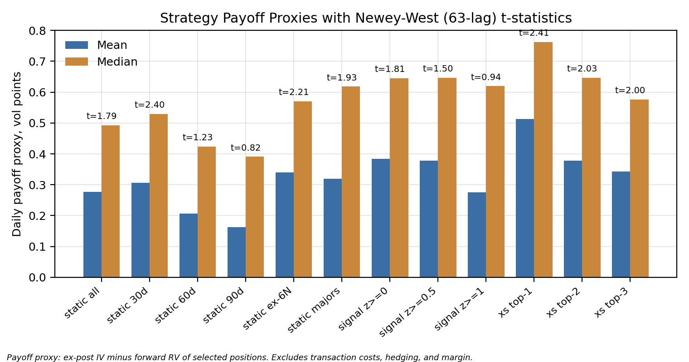
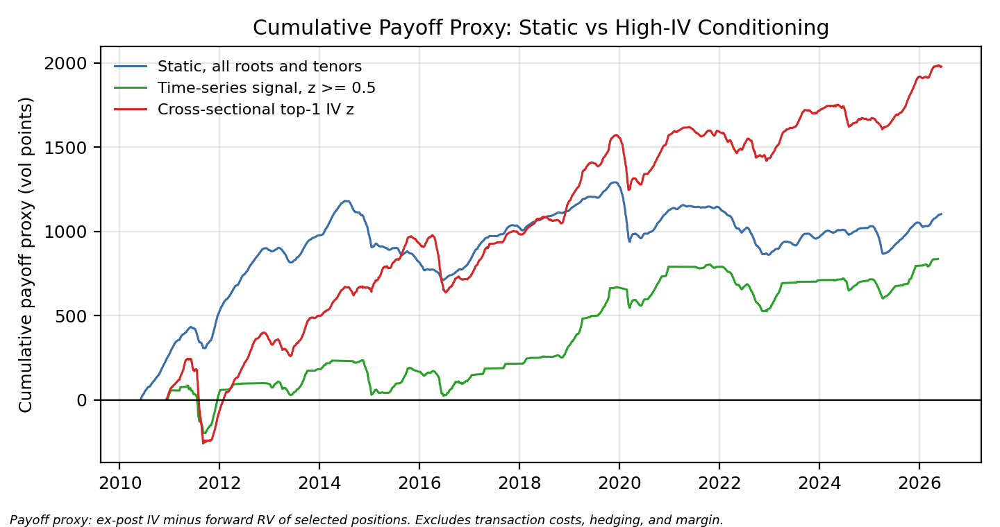

# Volatility risk premia in CME currency options

Option prices imply how much a currency will move. This project checks, over 16 years of CME
currency options, whether that implied volatility is usually higher than the volatility that
actually follows, and whether selling options when they look most expensive pays more.

Nicholas Hong · Nanyang Technological University

**Paper:** [`paper/vrp_paper.pdf`](paper/vrp_paper.pdf) · **Long-form report:** [`report/vrp_report_final.md`](report/vrp_report_final.md) · **Executed notebook:** [`notebooks/vrp_analysis.ipynb`](notebooks/vrp_analysis.ipynb)

## What I built

- A 15-step pipeline that turns six Databento batch jobs (986 DBN files, 11 GB of exchange-level
  CME GLBX.MDP3 statistics and definitions) into one panel of at-the-money options for seven
  currency futures: AUD (6A), GBP (6B), CAD (6C), EUR (6E), JPY (6J), NZD (6N) and CHF (6S),
  June 2010 to June 2026.
- An implied-volatility calculation for every contract, matched to the realised volatility of the
  exact futures contract the option is written on.
- Twelve short-volatility rules, each tested with statistics that allow for overlapping holding
  periods.

## Data

CME settlement prices, open interest and contract definitions from Databento. The raw files and
every derived panel are licensed market data and are not in this repository; `DATA.md` lists the
six jobs needed to rebuild them. What ships is the code, the aggregated statistics (`results/`,
`diagnostics/`), the charts, the report and the paper.

Two data problems had to be solved first.

The 2017 symbol migration. In mid-2017 CME retired its legacy American-style currency options and
replaced them with European-style contracts under new symbols. Querying one symbol per currency
shows a false break after 2017.

| New symbol (post 2017-07) | Economic root | Currency |
|---|---|---|
| ADU | 6A | AUD |
| GBU | 6B | GBP |
| CAU | 6C | CAD |
| EUU | 6E | EUR |
| JPU | 6J | JPY |
| CHU | 6S | CHF |
| 6N (unchanged) | 6N | NZD |

Source rule: legacy symbols for all seven roots before 2017-07; from 2017-07 the new symbols for
6A, 6B, 6C, 6E, 6J and 6S, plus legacy 6N only.

The legacy 6N anomaly. In 2013, 612 legacy 6N option rows settle at implied volatilities above 20
percent (median 28.5, highest 39.9) against a median realised volatility of 9.5 percent. Across
the whole sample, 128 daily cells combine implied volatility above 20 percent with no recorded
open interest, and 102 of them are 6N in 2013. Open interest cannot explain the anomaly by itself,
because it is missing for almost every 6N row before 2014, normal ones included (10 of the 3,526
rows in 2013 carry a value). The cut-off was chosen after comparing implied with realised
volatility over the full sample, so it was set with hindsight. 6N enters the sample from
2014-01-01 and has no option data from January 2017 to September 2018.

## Method

- Implied volatility (IV) is backed out of each settlement price with the Black-76 formula for
  options on futures, at-the-money, with r = 0 and time to expiry = days to expiry / 365.25.
- Realised volatility (RV) is measured on the specific futures contract under each option, over
  the following 30, 60 or 90 calendar days, annualised by trading days, with a guard against gaps
  longer than 14 calendar days.
- Each option is assigned to the nearest of the 30, 60 and 90-day targets; duplicates are removed
  and contracts re-ranked by distance to the target tenor, distance from at-the-money, then open
  interest. Open interest is missing for 23 percent of rows, so it only breaks ties among rows
  that have it.
- The volatility risk premium (VRP) for a cell is IV minus the RV that followed. It is a payoff
  proxy, the spread a volatility seller would have captured: not executable P&L, with no
  transaction costs, delta hedging or margin.
- The signal is an IV z-score: how far today's IV sits from its own trailing 252-observation mean,
  in standard deviations, using only data up to t−1 (at least 126 observations). No look-ahead.
- Holding periods overlap from one day to the next, so ordinary t-statistics overstate
  significance. The tests use Newey-West t-statistics at 5, 21 and 63 lags, which allow for that
  overlap; NW63 below means 63 lags. They also report a t-statistic on every 21st observation,
  averaged over the 21 possible start days. That second statistic removes the overlap for 30-day
  cells only: 60- and 90-day windows still overlap at a 21-day spacing, so it is not an
  independent check on the Newey-West figure. Skew and kurtosis are reported for every variant.

Full rules, join logic and data notes are in `report/vrp_report_final.md` §3 to §4 and §7.

## Main result

Implied volatility is higher than the volatility that follows in 6 of 7 currencies, and selling
the currency whose options look most expensive nearly doubles the average payoff. Figures are in
volatility points per day.

| Result | Number |
|---|---|
| Median IV − RV spread positive | 6 of 7 roots; strongest JPY +0.87 vol points, NZD flat (−0.03) |
| Static short-vol proxy, all roots and tenors | mean 0.28 vol points/day, median 0.49, positive 65.6% of days, **NW63 t = 1.79**, t on 21-day-spaced observations = 2.27 |
| Static by tenor | 30d is the only robustly significant bucket (NW63 t = 2.40); 60d and 90d positive but weak |
| Cross-sectional rule: short the single most IV-elevated root per date and tenor | mean **0.51**, median 0.76, positive 67.2%, **NW63 t = 2.41**, t on 21-day-spaced observations = 2.71; weaker for top-2 and top-3 |
| Time-series thresholds (own z-score ≥ 0 / 0.5 / 1) | add little once the z-score uses trailing information only |
| Distribution | left-skewed everywhere: static skew −1.69, excess kurtosis 7.0; **2022 is negative for all seven roots** |





Shorting only the most IV-elevated root raises the mean payoff from 0.28 to 0.51, while the share
of positive days moves from 65.6% to 67.2%. All twelve tested strategies are in
`results/robust_strategy_summary_v3.csv`; the cross-sectional rule above has the highest mean and
the highest NW63 t of the twelve.

## What didn't work

- The static premium is only marginally significant: NW63 t = 1.79, below the usual 1.96.
- Selling volatility behaves like selling insurance. The mean sits below the median in all twelve
  variants, losses are large, and 2022 was negative for every currency.
- Waiting for a currency's own IV to look high (the time-series thresholds) adds little once the
  z-score uses trailing data only.
- The reported rule is the best of twelve variants, and the 6N cut-off was set with hindsight, so
  neither is an out-of-sample result.

## How to run

The analysis layer reruns in minutes from the working folder of step-10 outputs:

```
pip install -r requirements.txt                                   # Python 3.10 to 3.12
export FX_VRP_WORK=/path/to/fx_vrp_work                           # outside this repository
for s in 11_daily_panel 12_strategy_proxy 13_robust_stats 14_charts_tables; do python scripts/$s.py; done
```

The full rebuild from the Databento download:

```
export DATABENTO_BASE=/path/to/databento           # directory holding the six GLBX-* job folders
export FX_VRP_WORK=$DATABENTO_BASE/fx_vrp_work     # working directory for every derived artefact
python scripts/00_inventory.py                     # then 01 to 05, in order
python scripts/06_atm_export.py                    # monthly picks; repeat until ALL_DONE
python scripts/06_atm_export.py --finalize         # writes the ATM export that step 07 reads
python scripts/07_black76_iv.py
python scripts/08_research_panel.py
python scripts/09_futures_settle_series.py         # monthly parts; repeat until ALL_DONE
python scripts/09_futures_settle_series.py --finalize   # writes the series that step 10 reads
python scripts/10_vrp.py                           # then 11 to 14, in order
python scripts/build_notebook.py
```

Python 3.14 crashes the DBN conversion. Set both variables before running anything: with
`FX_VRP_WORK` unset, steps 02 onward fall back to the repository folder and would overwrite the
committed `diagnostics/` files and the notebook. The working directory grows to tens of
gigabytes; `results/`, `paper/figs/` and `diagnostics/` here are committed snapshots of what a
finished run writes into it.

`REPRO.md` lists the expected checkpoints: step 11 must print 70,714 daily rows; step 13 must
report static mean 0.2766 / NW63 t 1.7906 and top-1 mean 0.5126 / NW63 t 2.4139; the notebook's
final cell checks its own recomputation against the pipeline outputs, to within 0.0005 on means
and 0.005 on t-statistics.

## Pipeline

| Step | Script | Purpose | Key output (rows) |
|---|---|---|---|
| 0 | `00_inventory.py` | folder/manifest inventory | `diagnostics/inventory_summary.csv` |
| 1 | `01_convert.py` | DBN.ZST → parquet by role and month | 986 files |
| 2 | `02_coverage_audit.py` | stat-type and root-month coverage | diagnostics |
| 3 | `03_join_diagnostic.py` | benchmark months vs prior counts | all EXACT |
| 4 | `04_build_clean_v3.py` | monthly joined panels | 193 files, 32,525,006 |
| 5 | `05_validate_clean_v3.py` | validation vs targets | scorecard |
| 6 | `06_atm_export.py` | ATM 30/60/90 export, dedup, rerank | 440,467 |
| 7 | `07_black76_iv.py` | Black-76 IV | 440,462 valid |
| 8 | `08_research_panel.py` | research filters | 430,630 |
| 9 | `09_futures_settle_series.py` | futures settle series and log returns | 485,057 / 482,449 |
| 10 | `10_vrp.py` | forward realised vol and VRP panel | 430,630 (427,774 RV ok) |
| 11 | `11_daily_panel.py` | daily (date, root, tenor) panel; 6N from 2014 | 70,714 |
| 12 | `12_strategy_proxy.py` | 12 strategy payoff proxies, leak-free IV z | 40,887 strategy-days |
| 13 | `13_robust_stats.py` | NW 5/21/63 t, 21-day-spaced t, skew/kurtosis | 12-row summary |
| 14 | `14_charts_tables.py` | publication charts and tables 1 to 4 | 7 charts, 4 tables |
| | `build_notebook.py` | build and execute `notebooks/vrp_analysis.ipynb` | notebook |

Steps 1, 2, 4, 6 and 9 are long and accept `--budget <seconds>` (default 30). Each call works for
that long and stops, so repeat it until it prints `ALL_DONE`. The rebuild from the Databento
download matched an earlier build on 21 of the 22 comparable metrics in
`diagnostics/reproduction_scorecard.csv`; the single difference is 20 rows in 32.5 million. The
earlier build's figures are typed into the scripts as targets and that build is not kept, so the
comparison cannot be rerun from this repository.

## Repository layout

```
scripts/            pipeline steps 00–14 + build_notebook.py
paper/              vrp_paper.pdf, vrp_paper.tex, figs/ (the 7 charts, 200 dpi)
report/             vrp_report_final.md (long-form report)
notebooks/          vrp_analysis.ipynb (executed, outputs retained)
results/            robust_strategy_summary_v3.csv, tables/table_1–4.csv
diagnostics/        reproduction scorecard, coverage audits, per-root and per-year medians
REPRO.md            working-directory layout and re-run checkpoints
DATA.md             data sources, job specification, licensing
requirements.txt    pinned minimum versions
LICENSE             MIT (code); the data itself is not redistributed
```

## Limitations

Payoff proxies, not P&L. Settlement marks, not executable prices. No delta hedging, so the proxy
measures the volatility spread rather than an isolated hedged premium. r = 0 in the Black-76
inversion (the premium is insensitive to r at these tenors). Realised volatility is measured over
the nominal 30, 60 or 90 days, while each option's own expiry sits up to 15 days from that target
(7 on average). The reported rule is the best of twelve variants and the 6N cut-off was set with
hindsight, so neither is an out-of-sample result. 6N remains thin after 2014: 76.6 percent of its
daily cells have no recorded open interest. Research and educational use only.
